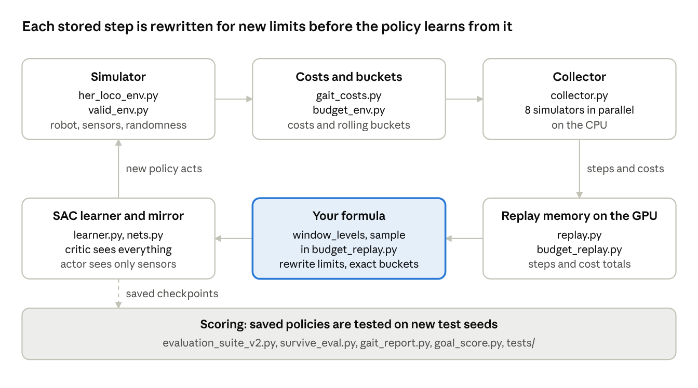

# Learning the Biped Codebase

Nov 6, 2026 · @yasho

## The big picture

The code is a loop: simulators make experience, the replay memory stores it, your formula rewrites it for new limits, and the learner improves the policy that makes the next experience.



The highlighted box is your contribution. Everything else is the machinery around it.

## Reading order

Read these files in this order, because each step uses the one before it. All paths are under `/home/rpuser1/yasho/rl/BipedRobot/`.

1. **The robot and the simulator:** `envs/her_loco_env.py`, then `fast/valid_env.py`. Look for what the robot senses each step, how the speed command is chosen, and how the reward is built.
2. **The costs and the bucket:** `fast/gait_costs.py`, then `fast/budget_env.py`. Look for how flight, slip and torque are measured, and how the bucket fills and drains.
3. **Your formula:** `fast/budget_replay.py`. This is the core of your contribution. Look at `window_levels` and `sample`.
4. **Learning:** `fast/replay.py`, `fast/learner.py`, `fast/nets.py` and `fast/mirror.py`. Look for how SAC updates the networks, and what the policy is allowed to see.
5. **The training loop:** `fast/train.py` and `fast/collector.py`. Look for how all the parts are joined.
6. **Scoring and tests:** `evaluation_suite_v2.py`, the tools in `diagnostics/audit_2026-10-31/claude_audit/v2/`, and `tests/`. Look for how a result is measured and how the code is checked.

Tip: each file starts with a note at the top that says what it does and why. Read that note before the code.

## Step 1: the robot and the simulator

The simulator runs your robot's MuJoCo model at 50 control steps a second and gives the policy what the robot would sense. `her_loco_env.py` is the base environment from your project. `valid_env.py` adds the realism fixes.

| Where | What it does |
| --- | --- |
| `her_loco_env.py:44` `HERLocoEnv` | The walking environment, loaded from `envs/assets/robotV2/robot_v2_train.xml` |
| `her_loco_env.py:566` `_sample_goal` | Picks the speed command for each episode: forward 0.1 to 0.3 m/s, small sideways and turning values, and zero 20% of the time |
| `her_loco_env.py:740` `_get_obs_dict` | What the robot senses: joint angles and speeds, gyro, gravity direction and the previous action |
| `her_loco_env.py:426` `compute_reward` | The speed reward. It is highest when the measured speed matches the command |
| `her_loco_env.py:780` `_get_info` | Everything measured each step: foot contacts, touchdowns, torque, slip |
| `her_loco_env.py:945` `_apply_domain_randomization` | Random floor friction, body mass and motor strength, so the policy cannot rely on one exact robot |
| `valid_env.py:53` `ValidLocoEnv` | Fixes so the simulator behaves more like the real robot |
| `valid_env.py:167` `_servo_curve` | Servo strength falls as joint speed rises, like the ST3215 at 12 V |
| `valid_env.py:177` and `:215` | Sensor noise, encoder rounding, and joint speed worked out from angle changes, as the real robot must do |
| `valid_env.py:174` `privileged` | Extra true values such as friction and mass, given only to the critic, never to the policy |
| `valid_env.py:129` `set_difficulty` | Starts training easy and ramps up the randomization |

The key idea: the policy sees only what the robot can measure. The critic, which judges actions during training only, may see everything.

## Step 2: the costs and the token bucket

Each control step, the robot spends some of each bad habit, and a bucket for each habit tracks whether it is over its limit. `gait_costs.py` measures the habits, and `budget_env.py` runs the buckets.

| Where | What it does |
| --- | --- |
| `gait_costs.py:57` `substep_loads` | At every physics step, the force on each foot and how fast a loaded foot slides |
| `gait_costs.py:101` `step` | Turns those into three costs: flight (both feet unloaded), stance slip in m/s, and torque saturation (motors at their limit) |
| `budget_env.py:47` `decode_rate` | Turns the setting `u` (0 = tightest, 1 = loosest) into a rate on a log scale |
| `budget_env.py:126` `set_budget` | Sets each bucket's rate `r` and size `B = r × 100 steps` |
| `budget_env.py:135` `_window_deficit` | The rolling bucket: how far over the allowance the robot is, looking back at most 100 steps |
| `budget_env.py:143` `bucket_levels` | Each bucket's level from full (1) to overdrawn (−1). Only the critic sees these |
| `budget_env.py:185` `step` | The reward gate: while any bucket is overdrawn, the speed reward is 0. The 0.2 bonus for staying up is kept |
| `budget_env.py:101`, `:106` and `:114` | The new style costs: foot lift, sole tilt, and low steps. `steps` counts touchdowns |

The bucket, as a formula. `c(t)` is the cost at step `t`, `r` the rate and `B` the bucket size:

```latex
b(t+1) = \min\big(B,\; b(t) + r - c(t)\big)
```

While the bucket never goes below zero, the cost in any window of `T` steps is at most `r × T + B`. That guarantee over every window, not just the whole episode, is why a rolling budget suits a robot.

## Step 3: your formula, hindsight relabeling

This is your contribution. When training reuses an old step, it rewrites both the speed target and the budget limits stored with it, then recalculates every bucket exactly as if those limits had been set from the start of the episode. One step of experience then teaches the policy about many limits.

| Where | What it does |
| --- | --- |
| `budget_replay.py:70` `add` | Stores each step with `S(k)`, the total cost spent so far in its episode |
| `budget_replay.py:98` `sample` | Picks a batch of stored steps and a later step from the same episode for each |
| inside `sample` | New speed target: the speed actually reached at that later step. This is ordinary hindsight relabeling (HER) |
| inside `sample` | New budget for each cost: keep the old one (25%), use the rate actually spent (50%), or draw a fresh one (25%) |
| `budget_replay.py:90` `window_levels` | Your formula: the bucket level at that step under the new limit, for the whole batch at once on the GPU |
| inside `sample` | Recomputes "over budget" and the reward under the new target and limits |

The formula. `S(k)` is the cost spent before step `k`, `r` the new rate, `W` the window of 100 steps and `B = r × W`:

```latex
F(k) = S(k) - r\,k, \qquad d(t) = F(t) - \min_{\max(0,\,t-W)\,\le\,k\,\le\,t} F(k), \qquad b(t) = B - d(t)
```

The robot is over budget when `d(t) > B`. Because `F` only needs the stored totals `S(k)`, any new rate can be applied afterwards without running the simulator again.

Why it matters: the papers closest to yours relabel one total per episode, which only needs the total at the end. A rolling budget depends on the whole history, so it needs this formula. `tests/test_budget_window.py` checks it against a slow step-by-step count and finds them exactly equal.

## Your formula, explained

The formula answers one question for any stored step: if the limit had been `r`, how far over its allowance would the robot be right now? It answers without running the simulator again.

**1. What is stored.** For each step `k` of an episode, the memory keeps `S(k)`, the total cost spent before that step. That is all the formula needs.

**2. The allowance line.** A limit of `r` per step allows `r × k` by step `k`. So `F(k) = S(k) − r k` says how far ahead of the allowance the robot is. A positive value means it has spent more than allowed so far, and a negative value means it has saved.

**3. Only recent overspending counts.** The bucket can't store savings beyond its size, and it forgets anything older than the window `W`. So the formula looks at how far `F` has risen since its lowest point in the last `W` steps. That rise, `d(t)`, is the overspending built up recently:

```latex
d(t) = F(t) - \min_{\max(0,\,t-W)\,\le\,k\,\le\,t} F(k)
```

**4. The verdict.** The bucket size is `B = r × W`. The robot is over budget when `d(t) > B`. The level the critic sees is `1 − d(t) / B`: 1 is full, 0 is empty, and below 0 is overdrawn.

**5. Why it is the token bucket.** Running the bucket step by step, `b(t+1) = min(B, b(t) + r − c(t))` with the same memory, gives exactly the same numbers. The example below and `tests/test_budget_window.py` both check this.

### A worked example

Take a window of `W = 5` steps, and an episode whose costs are 0, then 0.3 three times, then 0. The same stored costs are scored at two limits.

At a tight limit, `r = 0.1` and `B = 0.5`:

| After step | `S(k)` | `F(k)` | Lowest `F` in the last 5 | `d(k)` | Level | Over budget |
| --- | --- | --- | --- | --- | --- | --- |
| 0 | 0.0 | 0.0 | 0.0 | 0.0 | 1.0 | No |
| 1 | 0.0 | −0.1 | −0.1 | 0.0 | 1.0 | No |
| 2 | 0.3 | 0.1 | −0.1 | 0.2 | 0.6 | No |
| 3 | 0.6 | 0.3 | −0.1 | 0.4 | 0.2 | No |
| 4 | 0.9 | 0.5 | −0.1 | 0.6 | −0.2 | **Yes** |
| 5 | 0.9 | 0.4 | −0.1 | 0.5 | 0.0 | No |
| 6 | 0.9 | 0.3 | −0.1 | 0.4 | 0.2 | No |
| 7 | 0.9 | 0.2 | 0.1 | 0.1 | 0.8 | No |
| 8 | 0.9 | 0.1 | 0.1 | 0.0 | 1.0 | No |

At a loose limit, `r = 0.2` and `B = 1.0`:

| After step | `S(k)` | `F(k)` | Lowest `F` in the last 5 | `d(k)` | Level | Over budget |
| --- | --- | --- | --- | --- | --- | --- |
| 0 | 0.0 | 0.0 | 0.0 | 0.0 | 1.0 | No |
| 1 | 0.0 | −0.2 | −0.2 | 0.0 | 1.0 | No |
| 2 | 0.3 | −0.1 | −0.2 | 0.1 | 0.9 | No |
| 3 | 0.6 | 0.0 | −0.2 | 0.2 | 0.8 | No |
| 4 | 0.9 | 0.1 | −0.2 | 0.3 | 0.7 | No |
| 5 | 0.9 | −0.1 | −0.2 | 0.1 | 0.9 | No |
| 6 | 0.9 | −0.3 | −0.3 | 0.0 | 1.0 | No |
| 7 | 0.9 | −0.5 | −0.5 | 0.0 | 1.0 | No |
| 8 | 0.9 | −0.7 | −0.7 | 0.0 | 1.0 | No |

What the example shows:

- **One episode teaches two lessons.** The same stored costs are over budget at step 4 under the tight limit, so that step earns no speed reward, only the 0.2 bonus for staying up. Under the loose limit they are never over, so the reward is kept. The policy learns both from one run.
- **The window forgets.** Under the tight limit, `d` drops from 0.4 to 0.1 at step 7, because the overspending at steps 1 to 3 has left the 5-step window. Without the window, one early mistake would keep the bucket empty for the rest of the episode.

### How the new limit is chosen

For each stored step and each cost, the training code picks one of three limits:

- **The original limit** (25% of the time).
- **The rate actually spent** up to a later step (50%). This is the budget version of "the goal the robot actually reached", the core idea of hindsight relabeling.
- **A fresh random limit** (25%), so every setting keeps being practised.

### Why it is fast

Everything comes from the stored totals `S(k)`, so no simulation is rerun. `window_levels` in `fast/budget_replay.py` computes the formula for a whole batch in one pass on the GPU: subtract the allowance line, take the lowest value in the window, and subtract. It does this for the current step and the next one, which is what the reward needs.

### What it guarantees, and its limit

- **The guarantee:** while the robot never goes over budget, its cost in any window of `T` steps, up to `W`, is at most `r × T + B`.
- **The limit:** because `B = r × W`, a steady cost of up to twice `r` still never goes over. So the real cap on average cost is `2r`, not `r`. The step-budget setting of "2 steps per second" was chosen with this in mind.

## Step 4: learning

Two networks learn together with SAC (soft actor-critic). The actor is the policy that moves the robot, and the critic scores how good an action is. Everything runs on the GPU.

| Where | What it does |
| --- | --- |
| `replay.py:50` `GpuHerReplay` | The memory of past steps, a ring of the last 1 million, kept on the GPU |
| `replay.py:32` `relabel_reward` | The speed reward, recomputed for a rewritten target |
| `learner.py:72` `_step` | One SAC update: adjust the exploration weight, train the critic toward reward plus discounted future value, then train the actor toward actions the critic rates highly |
| `learner.py:122` `_capture` | Records the whole update once as a CUDA graph, so each later update is one fast GPU call |
| `nets.py:34` `Actor` | The policy network. Its `keep` list hides true speed and bucket levels, which the robot cannot measure |
| `nets.py:71` `Critic` | Two value networks; it also sees the hidden values and the true physics |
| `nets.py:27` `actor_inputs` | Works out which inputs the actor may read |
| `mirror.py:27` `obs_maps` | Swaps left and right in half of each batch, so every step also teaches the mirror-image step |
| `learner.py:60` `_smoothness` | The smoothness loss you tested. It is off unless switched on |

The key idea: the critic can use information the robot lacks, because the critic is only needed during training. The actor must work from the robot's own sensors.

## Step 5: the training loop

`train.py` joins all the parts: 8 copies of the simulator run in parallel on the CPU while the GPU learns. One run of 7.2 million steps takes about 4 hours with 4 runs sharing the GPU.

| Where | What it does |
| --- | --- |
| `train.py:75` `main` | Reads the config, builds the replay memory, the learner and the simulators, then loops |
| `collector.py:47` `_worker` | One simulator per CPU process, sharing memory with the trainer so nothing is copied slowly |
| `collector.py:93` `Collector` | Steps all 8 simulators at once while the GPU is busy updating |
| inside `main` | Each loop: the actor picks actions, the simulators step, the results go into replay, then the learner updates once per step |
| inside `main` | Ramps up the difficulty over the first 1.92 million steps, and loosens budgets early on |
| inside `main` | Saves a checkpoint every 400,000 steps, and logs costs and losses to `progress.csv` |

A run's settings come from a config file in `config/`. The main one is `config/v2_deploy_budget_alpha30.yaml`. The new style budgets add one line each, for example `costs: [flight, slip, torque, steps]` in `v2_deploy_budget_alpha30_steps.yaml`. The script that starts a full run, `diagnostics/audit_2026-10-31/claude_audit/v2/run_budget_deploy.sh`, shows every command-line option used.

## Step 6: scoring and tests

Every result is measured on test episodes the policy never trained on, and the code is checked by tests that compare it with slow, simple versions. The scoring tools are in `diagnostics/audit_2026-10-31/claude_audit/v2/`.

| Where | What it does |
| --- | --- |
| `evaluation_suite_v2.py:220` `run_episode` | Runs one test episode and measures survival, speed, slip, foot lift and gait |
| `evaluation_suite_v2.py:374` `classify_gait` | Labels each episode: alternating walk, running or bounding, hopping, standing |
| `survive_eval.py` | Tests a policy at named budget settings on many episodes, and keeps every episode's numbers |
| `budget_eval.py` | Lists the named budget settings, such as `all_mid` and `mid_human` |
| `gait_report.py` | Real steps per second, step length, foot lift, flat-foot share and sideways drift |
| `goal_score.py` | Scores results against the fixed walking goal, and prints PASS or fail per seed |
| `tests/test_budget_window.py` | Checks your formula against a slow step-by-step count |
| `tests/test_step_budget.py`, `tests/test_lift_budget.py` | Check the new style budgets in the same way |
| `tests/run_all_tests.sh` | Runs every test, then a short training run whose result must match a stored fingerprint, so a change cannot silently alter training |

The working rules for judging results are in `diagnostics/WORKING_RULES.md`, and every result is logged in `diagnostics/PROGRESS.md`.

## Try it yourself

These commands only read and test, so they are safe to run while training continues. Run them in the VS Code terminal, which is on the workstation. Don't start a training run yourself: 4 are already running, which is the limit.

1. Set up the shell:

```bash
cd /home/rpuser1/yasho/rl
PY=/home/rpuser1/miniconda3/envs/rl/bin/python
```

2. Check your formula against the slow count (about 1 minute):

```bash
$PY -m pytest BipedRobot/tests/test_budget_window.py -q
```

3. Watch a bucket drain. This runs random actions at the tightest budget and prints the costs, bucket levels and reward every 10 steps. The script is in the project:

```bash
$PY BipedRobot/diagnostics/audit_2026-10-31/claude_audit/v2/watch_bucket.py
```

You should see the first level (flight) fall from 1 to −1, "over" turn True, and the reward drop to 0.2, the bonus for staying up.

4. Score the 7.2 million step policies against the walking goal:

```bash
cd BipedRobot/diagnostics/audit_2026-10-31/claude_audit/v2
$PY goal_score.py "goal7m/deploylong7m_s{s}.json" "goal7m/deploycmdlong7m_s{s}.json"
```

5. Look at the stepping of one policy (about 1 minute):

```bash
cd /home/rpuser1/yasho/rl
N=fast_deploylong7m_20261102_seed4
$PY BipedRobot/diagnostics/audit_2026-10-31/claude_audit/v2/gait_report.py mine BipedRobot/checkpoints/$N/seed_4/sb3_her_final.pt BipedRobot/runs/$N/seed_4/resolved_config.yaml /tmp/mine.json medium 10 9700:9703 all_mid
```

It prints steps per second, foot lift, flat-foot share and more.

## Glossary

| Term | Meaning |
| --- | --- |
| SAC | Soft actor-critic, the learning method. It learns from stored past steps, which is what makes relabeling possible |
| HER | Hindsight experience replay: reuse a step as if the goal had been what the robot actually achieved |
| Relabeling | Rewriting the target and budgets stored with an old step, then recomputing its reward |
| Actor, policy | The network that chooses the robot's joint targets. It sees only what the robot can measure |
| Critic | The network that scores actions during training. It may see true speed, bucket levels and the physics |
| Token bucket | A budget that refills at rate `r` up to size `B`, and is spent by cost |
| Rate `r` | Allowed cost per control step. At steady cost, the 100-step window allows up to about twice this |
| Setting `u` | The budget dial from 0 (tightest) to 1 (loosest), turned into `r` on a log scale |
| Window `W` | How far back the bucket remembers an overspend: 100 steps, or 2 seconds |
| Deficit `d` | How far over the allowance the robot is. Over budget when `d > B` |
| Flight, slip, torque | The three original costs: both feet off the ground, a loaded foot sliding, and motors at their limit |
| Steps, low steps, tilted stance | The new style costs: touchdowns, touchdowns after a lift under 20 mm, and feet on the floor tilted over 8° |
| Domain randomization | Random friction, mass and motor strength in training, so the policy works on a range of robots |
| Realism `medium`, `full` | Test settings. Medium has 10 ms delay and no pushes. Full has 0 to 50 ms delay, backlash, and optional pushes |
| Seed | One independent training run with its own random start. Results count only across several seeds |
| Test seed | The random setup of one test episode. New test seeds mean the policy never saw them |
| Checkpoint | A saved copy of the policy at some point in training |
| Mirror | Swapping left and right to get free extra training data |
| Gait label | The evaluator's name for an episode's movement, such as alternating walk, bounding or standing |
